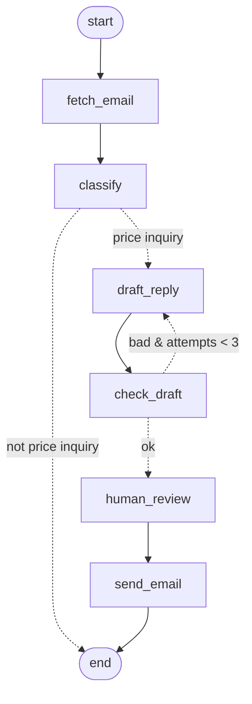

# סוכן מענה אוטומטי לפניות על מחירי צילום

LangGraph + LangSmith + Gemini – תרגיל הגשה 2

## מה הסוכן עושה
מייל נכנס → Gemini בודק אם זו פנייה על מחירים / חבילות צילום → אם כן, מנסח תשובה אישית ומנוסחת יפה
שמפנה לאתר הסטודיו (הקישור ב-`studio.json`), שם נמצאים המחירים ותיק העבודות →
הטיוטה נבדקת (בקוד: יש קישור ואין מחירים; ע"י LLM: טון ויחס אישי) ואם היא לא תקינה חוזרת לניסוח (עד 3 פעמים) → הגרף **עוצר** ומחכה לאישור שלי
(לשלוח / לערוך / לבטל) → רק אחרי אישור המייל "נשלח" (בשלב הפיתוח: נשמר בתיקיית `outbox/`).

## תרשים הגרף


(נוצר עם `python run.py --draw`, שמשתמש ב-`graph.get_graph().draw_mermaid()`)

| דרישה | איפה בפרויקט |
|---|---|
| LangGraph | `agent/graph.py` – `StateGraph` עם צמתים וקשתות |
| ענף מותנה | אחרי `classify` – `route_after_classify` |
| לולאה | `check_draft` → `draft_reply` – `route_after_check` (עד 3 ניסיונות) |
| interrupt / human-in-the-loop | `human_review` ב-`agent/nodes.py` + `Command(resume=...)` ב-`run.py` |
| דאטהסט + הערכה אוטומטית | `eval/` – 15 דוגמאות, 3 evaluators, ניסוי v1 מול v2 |

## מבנה
```
agent/state.py      # EmailState – מה עובר בין הצמתים
agent/nodes.py      # הצמתים, הפרומפטים (v1/v2) והראוטרים
agent/graph.py      # חיבור הגרף
run.py              # הרצה עם עצירה לאישור
eval/               # create_dataset / evaluators / run_experiment
studio.json         # שם הסטודיו וקישור לאתר
sample_emails/      # 10 מיילים לדוגמה
outbox/             # מיילים "שנשלחו"
```

## הרצה
```bash
python -m venv venv
venv\Scripts\activate
pip install -r requirements.txt
copy .env.example .env      # ולמלא מפתחות
python run.py                                   # כל המיילים
python run.py sample_emails/01_wedding_price.json
```

הערכה:
```bash
python -m eval.create_dataset
python -m eval.run_experiment v1     # לפני
python -m eval.run_experiment v2     # אחרי
```

## צילומי מסך מ-LangSmith
- trace שעובר בלולאה: `screenshots/loop_trace.png`
- trace שנעצר ב-interrupt: `screenshots/interrupt_trace.png`

## תוצאות לפני ואחרי

| evaluator | v1 (לפני) | v2 (אחרי) |
|---|---|---|
| classification | ? | ? |
| link_no_prices | ? | ? |
| answer_quality | ? | ? |

**מה שונה ב-v2:** הגדרה מדויקת של "פניית מחיר" + דוגמאות few-shot בסיווג, והוראות קשיחות בניסוח
(לא לכתוב מחירים, לשים את הקישור בשורה נפרדת, להתייחס אישית למה ששאלו ולהזמין לחזור אלינו).

## תובנה מה-traces
_(למלא אחרי ההרצה – לדוגמה: איזה מייל סווג לא נכון ב-v1 ולמה, או באיזה מקרה הלולאה חזרה ומה check_draft תפס)_
